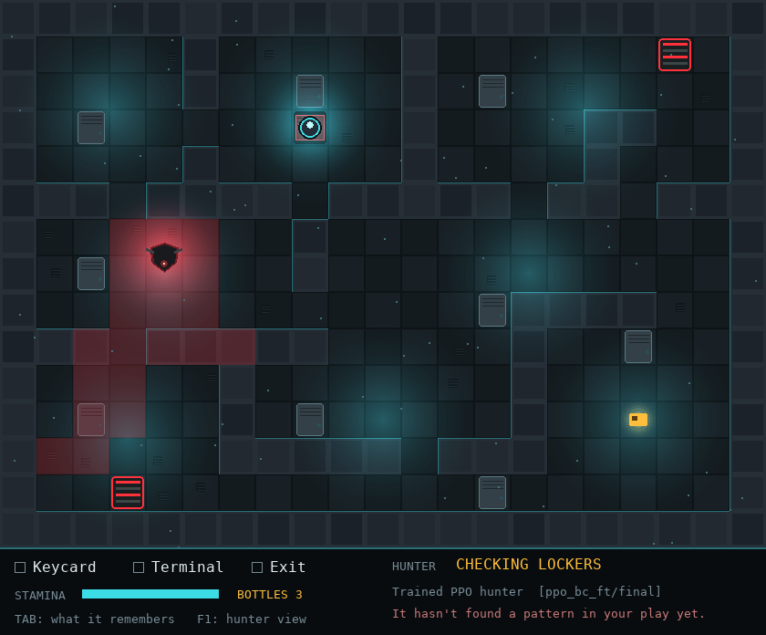
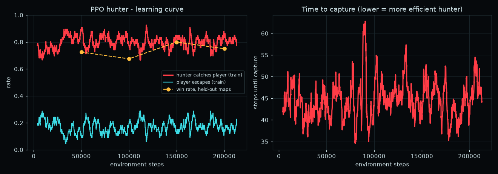
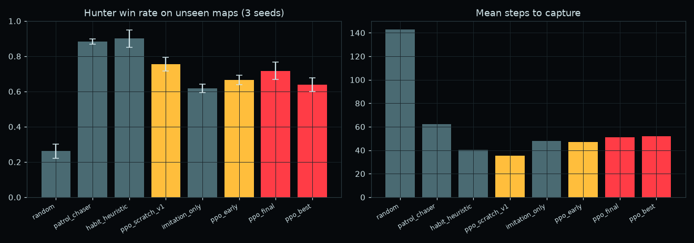
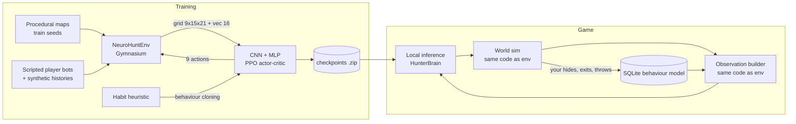
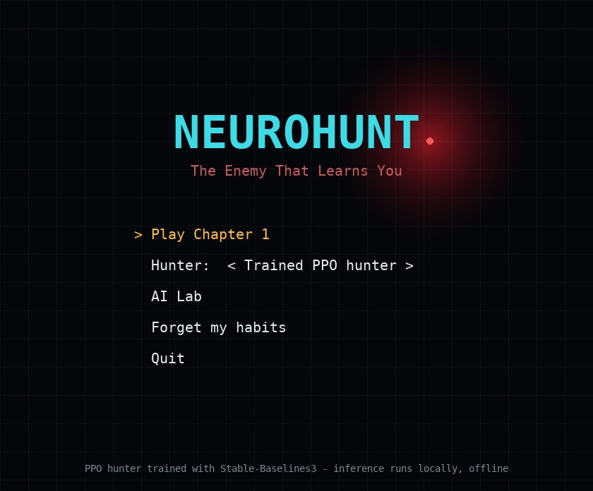
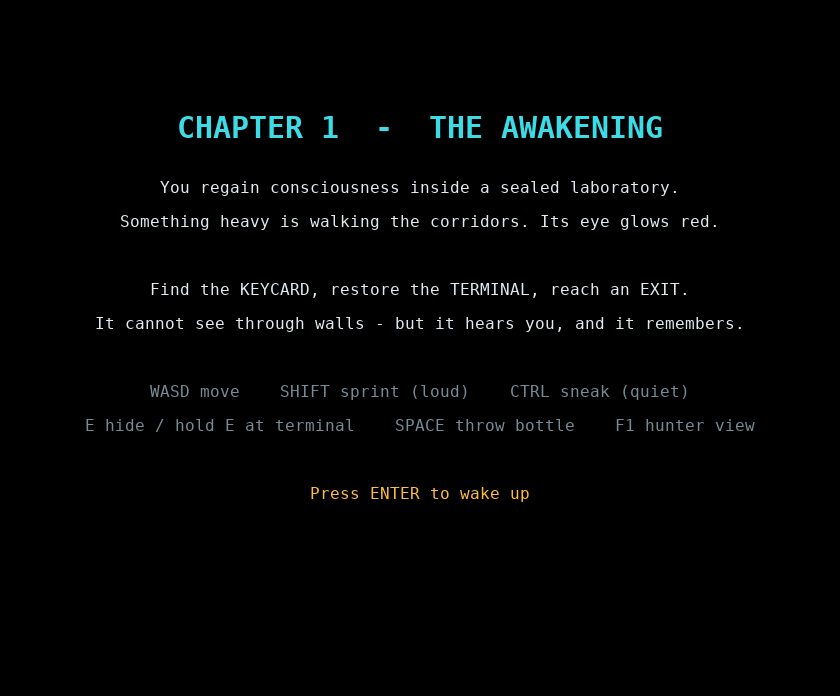
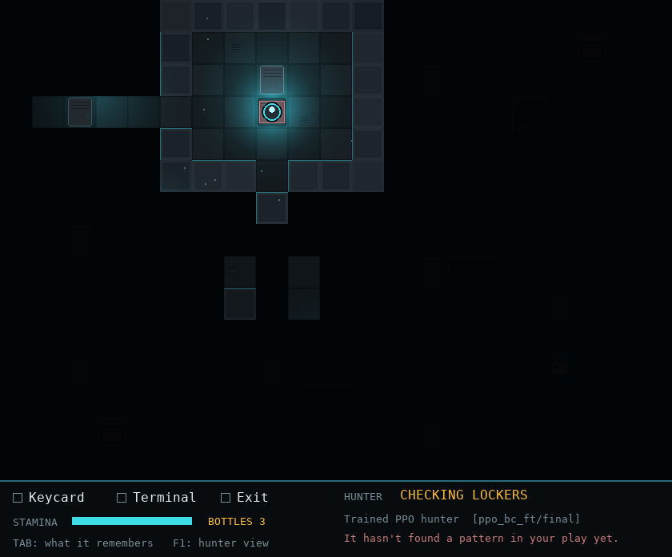
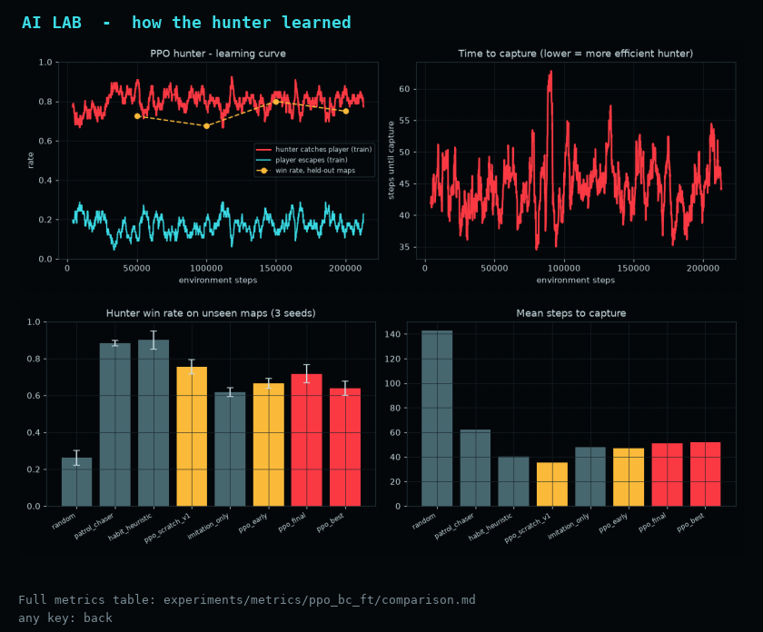

# NeuroHunt — The Enemy That Learns You

A sci-fi stealth survival game in **Python + Pygame** where the enemy is a **reinforcement-learning agent**.
The hunter was trained with **PPO (Stable-Baselines3 / PyTorch)** in a custom **Gymnasium** environment, ships as a saved checkpoint, and runs **offline inference** inside the game. A persistent **player-behaviour model** (SQLite) remembers your favourite hiding spots and exits across sessions and feeds them into the hunter's observations.



> **Honesty note.** The neural network does **not** learn while you play. Its weights are fixed after training. What adapts during play is the behaviour model: it records how *you* play, and the trained policy reacts to that information because it was trained on thousands of synthetic player histories.

---

## Highlights

| | |
|---|---|
| **Custom Gymnasium env** | Procedural multi-room facilities, wall-blocked line of sight, 100° field of view, hearing system, hiding lockers, keycard → terminal → exit objective chain. |
| **Partial observability** | The hunter never sees the player's true position unless it is in its field of view. It gets a 9-channel 15×21 map image (walls, own position, visible tiles, perceived player, last known position + noises, behaviour prior, exits, own trail, lockers checked) plus 16 scalar features. |
| **Model** | CNN feature extractor (3 conv layers) + MLP for scalars → shared PPO actor-critic (`MultiInputPolicy`). 9 actions: 4 moves, scan, and 4 high-level intents (pursue last known, investigate noise, intercept exit, check hiding spot). |
| **Training opponents** | 7 scripted player bots (wanderer, hider, runner, trickster, creature of habit, unpredictable, plus a **held-out "ghost"** never seen in training) with randomised parameters and synthetic play histories. |
| **Evaluation** | Unseen maps (seeds ≥ 10 000 never used in training), 3 seeds × 60 episodes, per-profile breakdown, three baselines, early vs final checkpoints, imitation-only and from-scratch ablations. |
| **Game** | Playable Chapter 1, dark red/teal top-down style, fog of war, noise ripples, synthesized audio, stamina/sneak/sprint, thrown distractions, hunter state HUD, "hunter view" (F1) and "what it remembers" (TAB) debug overlays, in-game AI Lab with the learning curves. |
| **Engineering** | Reproducible JSON configs, crash-tolerant resumable training, versioned checkpoints, TensorBoard logs, CSV metrics, 36 pytest tests (incl. headless game smoke test), GitHub Actions CI, PyInstaller build script. |

---

## Results (measured, not projected)

Held-out evaluation: unseen procedural maps, 3 seeds × 60 episodes per hunter. Win = the hunter catches the player before they escape or time runs out.

| Hunter | Win rate | Escape rate | Steps to capture | Exit interceptions | False investigations / ep |
|---|---|---|---|---|---|
| Random | 26.1% ± 3.9% | 56.1% | 142.9 | 6.7% | 0.21 |
| Patrol + chase (scripted) | 88.3% ± 1.4% | 10.0% | 62.1 | 5.0% | 0.50 |
| Habit heuristic (scripted, uses the behaviour model) | **90.0% ± 4.9%** | 7.8% | 40.4 | 6.1% | 0.19 |
| PPO from scratch (`ppo_cnn_v1`, 184k steps) | 75.6% ± 3.9% | 23.3% | **35.5** | 7.2% | **0.11** |
| Imitation only (behaviour cloning, `bc_init`) | 61.7% ± 2.4% | 23.3% | 47.9 | 17.2% | 0.15 |
| PPO early checkpoint (25k steps) | 66.7% ± 2.7% | 19.4% | 47.0 | 19.4% | 0.12 |
| **PPO final (`ppo_bc_ft`, BC + 213k PPO steps)** — used in game | 71.7% ± 4.9% | 17.8% | 51.1 | **22.2%** | 0.16 |




### What the numbers say
- **Learning is real**: every trained hunter beats random by ~45–50 points on maps it has never seen, and PPO fine-tuning lifts the imitation policy from 61.7% → 71.7%.
- **The learned hunters behave differently from the scripts**: the fine-tuned PPO hunter intercepts the player at an exit **3–4× more often** (22% vs 5–6%) and is fooled by thrown distractions less often than the patrol script.
- **The scripted baselines are still stronger overall.** They use exact shortest-path planning, which is hard to beat with ~200k CPU steps. Closing that gap is the next milestone (see roadmap) — I report it instead of hiding it.
- **Failure mode found and documented**: PPO from scratch collapsed onto a single intent (`check_hiding_spot`) within 50k steps (deterministic evaluation identical at 50k/100k/150k). It's fast when it wins, but it's a degenerate policy. The fix used for the shipped hunter was a **behaviour-cloning warm start** from the habit heuristic, then PPO fine-tuning with a smaller learning rate and clip range (`experiments/configs/ppo_bc_ft.json`).

Full tables (including per-player-profile win rates and per-seed results): [`experiments/metrics/ppo_bc_ft/comparison.md`](experiments/metrics/ppo_bc_ft/comparison.md) and `comparison.json`.

---

## Architecture



The game and the training environment share one simulation core (`environment/world.py`) and one observation builder (`environment/observations.py`), so the hunter perceives the game exactly as it did during training.

```
environment/   config, procedural maps, world sim (LOS/FOV/hearing), player bots, observations, rewards, Gymnasium env
ai/            CNN extractor, PPO training, behaviour cloning, evaluation suite, plots, baselines, player-behaviour model
game/          Pygame app: scenes (Chapter 1, menu, end, AI Lab), renderer, audio, hunter brain
experiments/   configs/, metrics/ (CSV + JSON), learning_curves/ (PNG)
ai/checkpoints versioned weights for every run reported above
tests/         36 tests: map connectivity, LOS through walls, FOV, hiding, observation bounds & no-leak, behaviour persistence, env API, game smoke test
```

---

## Quick start

```bash
git clone https://github.com/bileldh-ing/NeuroHunt.git
cd NeuroHunt
python -m venv .venv && source .venv/bin/activate      # Windows: .venv\Scripts\activate
pip install -r requirements.txt

python -m game.main                      # play (menu lets you pick the hunter)
python -m game.main --hunter trained     # straight into Chapter 1 vs the PPO hunter
python -m game.main --hunter early       # vs the 25k-step checkpoint
python -m game.main --hunter heuristic   # vs hand-written rules
```

**Controls:** WASD/arrows move · Shift sprint (loud, uses stamina) · Ctrl/C sneak (quiet, slow) · E hide in a locker / hold at the terminal · Space throw a bottle · TAB show what the hunter remembers about you · F1 hunter view · Esc menu.

## Reproduce the AI

```bash
# 1. behaviour-cloning warm start (~50k expert samples)
python -m ai.pretrain_bc --config experiments/configs/ppo_bc_ft.json --samples 50000

# 2. PPO fine-tuning (resumable; checkpoints every 25k steps, held-out eval every 50k)
INIT=ai/checkpoints/ppo_bc_ft/bc_init.zip ./run_training.sh experiments/configs/ppo_bc_ft.json 3600
#    or from scratch:  python -m ai.train --config experiments/configs/ppo_cnn_v1.json

# 3. evaluation on unseen maps + baselines, then plots
python -m ai.evaluate --compare --run ppo_bc_ft --episodes 60 --seeds 0 1 2 \
       --also ppo_scratch_v1=ai/checkpoints/ppo_cnn_v1/final.zip
python -m ai.plot_curves --run ppo_bc_ft
tensorboard --logdir experiments/metrics

# tests
python -m pytest -q
```

All results above were produced on a 2-vCPU CPU-only machine; seeds and hyper-parameters are in `experiments/configs/` and copied next to each checkpoint.

## Build an executable

```bash
pip install pyinstaller
python build_exe.py          # -> dist/NeuroHunt/ (includes maps + checkpoints, runs offline)
```

---

## Reward design

| Event | Reward |
|---|---|
| Catch the player | +100 |
| Reach the exit the player is heading for before them (intercept) | +30 |
| Reach a real clue (fresh noise / last known position) | +10 (+5 for noises) |
| Player in view (tracking) | +2 / step |
| Searching / scanning with nothing useful nearby | −5 (−1 when a target existed) |
| Repeated wall collisions | −10 (first bump −2.5) |
| Player escapes | −100 |
| Time step | −0.1 |

Rewards are scaled by 0.01 for PPO stability. Thrown bottles create noises flagged as fake, which is how *false investigations* are measured.

## Roadmap
- Longer training on GPU and self-play-style curriculum (harder bots as the hunter improves) to beat the scripted baselines.
- Recurrent policy (LSTM) so the hunter keeps memory beyond the observation channels.
- Chapter 2–4 (light switches, doors, cameras, final lockdown) — design in [`docs/STORY.md`](docs/STORY.md).

## Screenshots

| Menu | Chapter intro | Player view (fog of war) | AI Lab |
|---|---|---|---|
|  |  |  |  |

Concept art that inspired the mood: [`docs/concept_art.webp`](docs/concept_art.webp).

---

**Author:** Bilel Dhahri — Software Engineer (ISSAT Sousse, 2026). MIT License.
